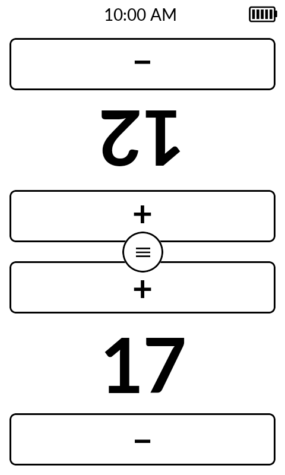
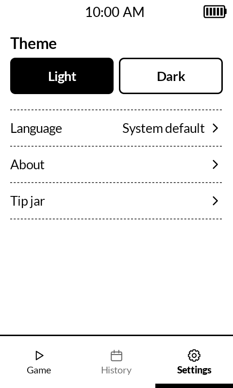

# Lifepoints

An offline life counter for trading card games such as Magic: The Gathering, Pokémon TCG and Lorcana.
Made for the [Mudita Kompakt](https://mudita.com/products/phones/mudita-kompakt/) and its E Ink screen.

  
  
  
  

## Features

- Two-player life counter. Start at 20, 30, 40 or any custom value.
- Tap − or + to change life by 1, or hold to change it by 10 at a time.
- The total of your last changes is shown above the life, for example −7 after an attack.
- A short vibration confirms each change. You can turn it off in Settings.
- The game is saved, so you can close the app and continue later.
- Each half of the table has fixed colours: white at the top, black at the bottom.
- 63 languages. The app follows the phone's language, or you can choose one in Settings.
- Fully offline. No account, ads, tracking or permissions.

Three- and four-player games and game history are planned.

## Install

Install Lifepoints from [InkApps](https://inkapps.mudita.com/) on your Kompakt, or download the APK from
[GitHub Releases](https://github.com/dkarski/lifepoints/releases/latest). Both are signed with the same key, so you can
update from either source without losing your game. To verify a download, see [SECURITY.md](SECURITY.md).

Requires Android 12 or later.

## Support and contact

Lifepoints is free. If you enjoy it, you can leave a tip:

For bugs and ideas, open an [issue](https://github.com/dkarski/lifepoints/issues) or email
daniel.karski5q@gmail.com.

## Privacy and license

Lifepoints collects no data. See the [Privacy Policy](docs/PRIVACY_POLICY.md) and [Terms of Use](docs/TERMS_OF_USE.md).

Copyright 2026 Daniel Karski. Licensed under the [Apache License 2.0](LICENSE).

To build the app or contribute, see [CONTRIBUTING.md](CONTRIBUTING.md).
