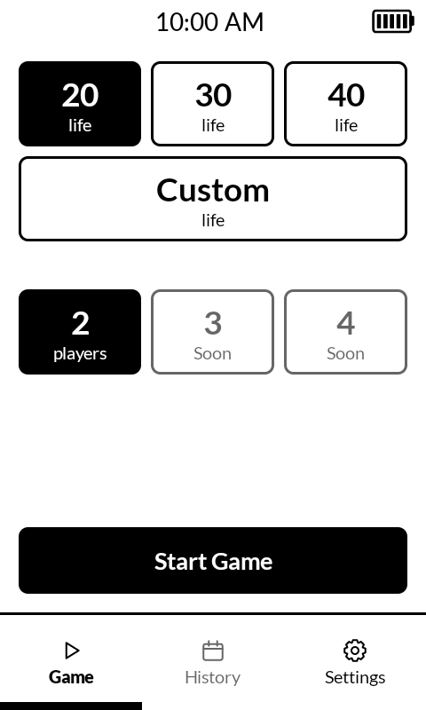
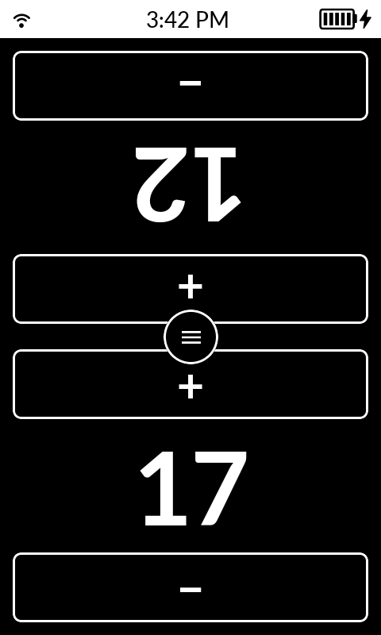

# Lifepoints

A simple, offline life counter for trading card games such as Magic: The Gathering, Pokémon TCG or
Lorcana, made for the [Mudita Kompakt](https://mudita.com/products/phones/mudita-kompakt/) E Ink phone.

  
  
  

## Features

- Life counter for two players, with starting life 20, 30, 40 or any custom value.
- Your game is saved, so you can close the app and continue later.
- Light and dark themes, designed for the E Ink screen.
- English and Polish, following your phone's language.
- Works fully offline: no account, no ads, no tracking and no permissions.

Games for three and four players and game history are planned.

## Get the app

Lifepoints is distributed through **InkApps**, the app store on the Mudita Kompakt.

You can also download the signed APK from the [latest release](https://github.com/dkarski/lifepoints/releases/latest)
and install it yourself. Updates from InkApps and from GitHub releases are signed with the same key, so they install
over each other without losing your game or settings.

Lifepoints requires Android 12 (API 31) or later and is designed for the Kompakt's 480×800 E Ink screen.

## Support

Lifepoints is free. If you enjoy it, you can leave a tip:

## Contact

Ideas, bugs or questions: open an [issue](https://github.com/dkarski/lifepoints/issues) or write to
daniel.karski5q@gmail.com (the address is also in the app, in Settings).

## Privacy and license

Lifepoints collects no data. See the [Privacy Policy](docs/PRIVACY_POLICY.md) and the [Terms of Use](docs/TERMS_OF_USE.md).

Copyright 2026 Daniel Karski. Licensed under the [Apache License 2.0](LICENSE).
Third-party licenses are listed in the app (Settings > About > Open source licenses).

Building from source, contributing and releasing: see [CONTRIBUTING.md](CONTRIBUTING.md).
